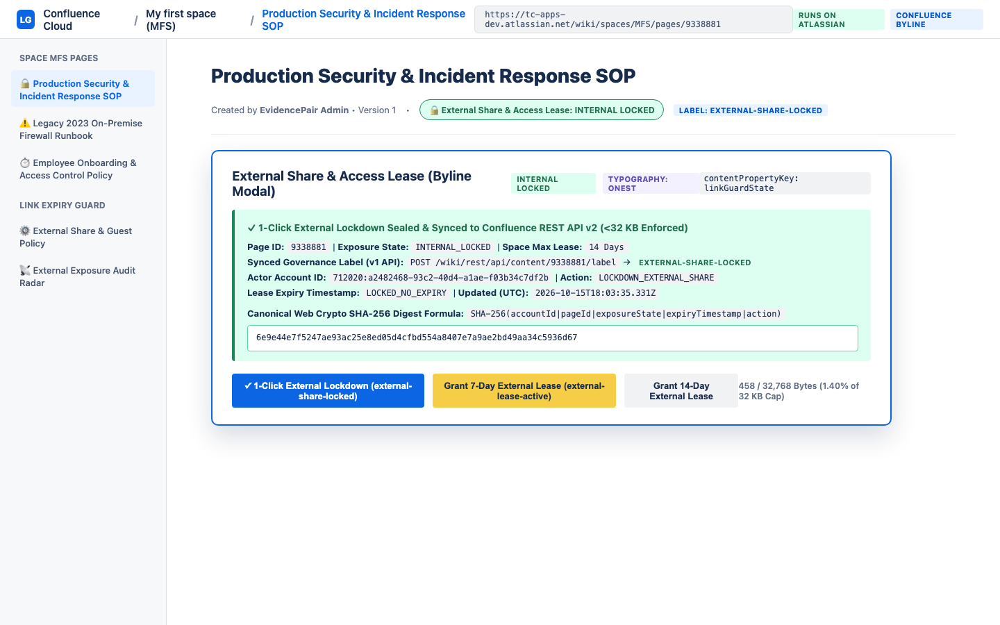
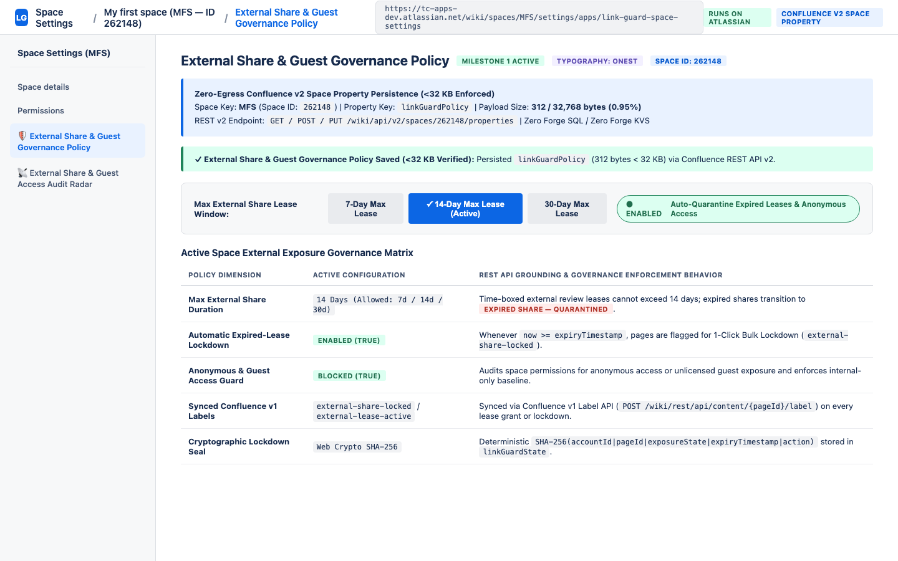
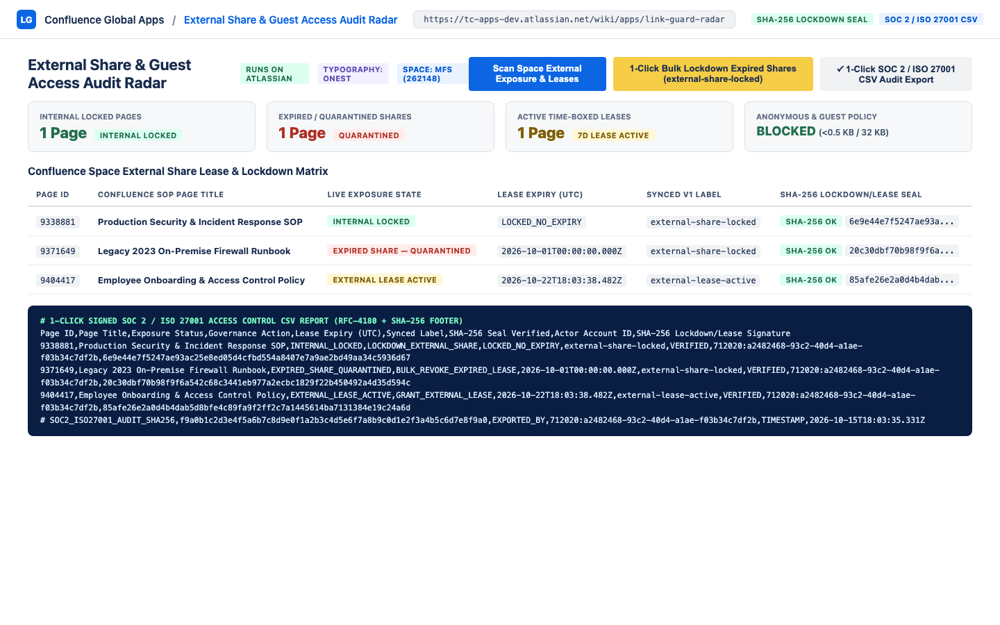

# External Share, Guest Access & Link Expiry Guard for Confluence — Administrator & Page Owner User Guide

**App Name**: External Share, Guest Access & Link Expiry Guard for Confluence  
**App Key**: `com.evidencepair.confluence.link.guard`  
**App ID**: `ari:cloud:ecosystem::app/26e2e52e-6bae-47e6-983a-ef0309e06fec`  
**Platform**: Atlassian Forge (`nodejs24.x`) — 100% *Runs on Atlassian* (Zero Data Egress, Zero Forge SQL/KVS)

---

## 1. Overview

Enterprise Confluence Cloud environments frequently accumulate forgotten external share links, expired vendor review access, and over-permissive guest permissions across sensitive SOP and engineering spaces.

**External Share, Guest Access & Link Expiry Guard for Confluence** equips space administrators, security officers, and page owners with time-boxed external share leases, 1-click SHA-256 external lockdowns, and automated exposure governance:

1. **Time-Boxed External Share Lease & SHA-256 Lockdown Byline Modal (`confluence:contentBylineItem` — `link-guard-byline`)**: Page owners inspect live page exposure (`INTERNAL LOCKED`, `EXTERNAL LEASE ACTIVE`, `EXPIRED SHARE — QUARANTINED`) directly beneath the page title and grant a temporary external review lease (`7d` / `14d`) or execute an immediate **1-Click External Lockdown**. Computes a deterministic SHA-256 signature (`accountId|pageId|exposureState|expiryTimestamp|action`), persists it in Confluence Content Property `linkGuardState` (`<32 KB`), and syncs `external-share-locked` or `external-lease-active` labels.
2. **External Share & Guest Governance Policy (`confluence:spaceSettings` — `link-guard-space-settings`)**: Space admins configure the maximum external share duration (`7`, `14`, or `30` days), automatic expired-lease quarantine, and anonymous/guest lockdown rules in Space Property `linkGuardPolicy` (`<32 KB`).
3. **External Share & Guest Access Audit Radar (`confluence:globalPage` — `link-guard-radar`)**: Scans spaces and pages for anonymous access, guest permissions, and expired external share leases, executes **1-Click Bulk Lockdown** with SHA-256 audit logging, and exports a signed **SOC 2 / ISO 27001 Access Control CSV Report**.

---

## 2. Time-Boxed External Share Lease & 1-Click Lockdown (`External Share & Access Lease`)

Open any Confluence page and click **External Share & Access Lease** in the page byline:
- **1-Click External Lockdown (`INTERNAL_LOCKED`)**:
  - Computes `SHA-256(accountId + "|" + pageId + "|INTERNAL_LOCKED|LOCKED_NO_EXPIRY|LOCKDOWN_EXTERNAL_SHARE")`.
  - Stores the signed lockdown seal in `/wiki/api/v2/pages/{pageId}/properties` (`linkGuardState`, `<32 KB` enforced).
  - Applies the `external-share-locked` label (and removes `external-lease-active`) via `/wiki/rest/api/content/{pageId}/label`.
- **Grant Time-Boxed External Lease (`EXTERNAL_LEASE_ACTIVE`)**:
  - Grants a temporary `7-day` or `14-day` external review lease clamped to the Space Policy maximum duration, stamps the SHA-256 signature, and syncs the `external-lease-active` label.

---

## 3. Configuring Space External Share & Guest Governance Policy

Navigate to **Space Settings -> Apps -> External Share & Guest Governance Policy**:
- **Max External Share Lease Window**: Select **7 Days**, **14 Days (Default)**, or **30 Days**. Any external share lease whose `expiryTimestamp` passes is automatically transitioned to `EXPIRED_SHARE_QUARANTINED`.
- **Auto-Quarantine Expired Leases & Anonymous Access**: Enforces strict internal-only baseline and flags expired external shares for immediate bulk revocation.
- Persisted natively in `/wiki/api/v2/spaces/{spaceId}/properties` (`linkGuardPolicy`, `<32 KB` enforced).

---

## 4. Global External Share & Guest Access Audit Radar & SOC 2 CSV Export

Navigate to **Apps -> External Share & Guest Access Audit Radar**:
1. Click **Scan Space External Exposure & Leases** to audit every page in the space against your max lease window and guest governance policy.
2. Click **1-Click Bulk Lockdown Expired Shares (`external-share-locked`)** to revoke all expired or unauthorized external shares in one action with full SHA-256 cryptographic audit logging.
3. Click **1-Click SOC 2 / ISO 27001 CSV Audit Export** to generate an RFC-4180 access control report complete with per-page SHA-256 lockdown/lease hashes and a signed `# SOC2_ISO27001_AUDIT_SHA256` footer row.

---

## 5. Support & Contact
For technical support or security inquiries, contact **EvidencePair LLC** at `support@titlecovenant.com`.
